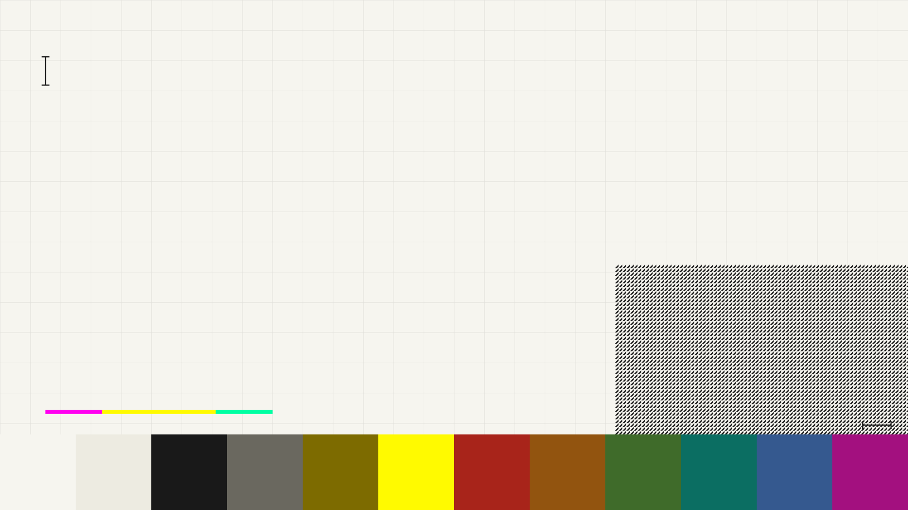

# omarchy-theme-endfield

An Omarchy theme built from the *Arknights: Endfield* design language: paper
white, ink black, one signal yellow, hard 2px rules and square corners — the
way the official site at <https://endfield.hypergryph.com> and the game's own
panels paint their interfaces.



## Install

```bash
omarchy theme install https://github.com/CARVIN94/omarchy-theme-endfield
omarchy theme set theme-endfield
```

`omarchy theme install` derives the theme name from the repository name: it
strips a leading `omarchy-` and a trailing `-theme`, so this repository installs
as **`theme-endfield`**. To have it as plain `endfield`, rename the installed
directory — a theme directory you wrote yourself is not held to the safety list
that applies to cloned ones:

```bash
mv ~/.config/omarchy/themes/theme-endfield ~/.config/omarchy/themes/endfield
omarchy theme set endfield
```

To work on it locally, install from the checkout itself and re-run `set` after
each edit:

```bash
omarchy theme install /path/to/omarchy-theme-endfield
omarchy theme set theme-endfield
```

## What ships

| File | Purpose |
| --- | --- |
| `colors.toml` | The whole palette — Omarchy renders Alacritty, foot, Ghostty, kitty, btop, helix, Neovim, tmux, VS Code, Chromium, Obsidian, Claude and the shell from it |
| `shell.menu.toml`, `shell.launcher.toml`, `shell.popups.toml`, `shell.bar.toml` | Section overrides merged into the generated `shell.toml`, so the rest of the shell keeps following the shipped template |
| `backgrounds/` | Two flat contour backgrounds (deep `#111827`, paper) in the wiki's module-card reading, the official version key visual, and the solid `omarchy.png` fallback |
| `icons.theme`, `keyboard.rgb`, `chromium.theme` | Yaru-yellow icons, signal-yellow keyboard RGB, paper-white Chromium frame |
| `preview.png` | Theme-switcher thumbnail |

Lua files, terminal configs and `vscode.json` are deliberately absent: Omarchy
refuses to stage those from a theme cloned out of a git repository, because
they run code or spawn programs. Everything here is colour.

## The palette

Values are measured, not invented — `ASSETS.md` records the evidence and the
roles each one plays on the site.

| Token | Value | Role |
| --- | --- | --- |
| `background` | `#F6F5EF` | Paper — the site's dominant field |
| `foreground` | `#191919` | Ink — body copy and hatch fills |
| `selection` | `#FFFA00` | Signal yellow, also the selected-row block |
| `accent` | `#7D6B00` | Signal yellow shaded to stay legible on paper |
| `cyan` | `#0B6E62` | Mint signal, shaded |
| `magenta` | `#A3107F` | Magenta signal, shaded |
| `blue` | `#35598F` | The key visual's technical blue |

House rules, taken from the game's own UI rather than generic theming:

* The selected menu/launcher row is a **signal-yellow block with ink text**,
  never a tint of the background.
* Panels are framed by a hard **2px ink rule**, not a hairline.
* Frames stay square. The shell mirrors Hyprland's `decoration:rounding`, so
  square means `decoration:rounding 0`.
* Red is for warning and event accents only, sampled from the game as
  `#D72F3B` and shaded for whichever field it lands on.

## Dark variant

`variants/dark/colors.toml` is the other half of the aesthetic: the game's own
panels, sampled from the UI archives listed in `ASSETS.md` — neutral near-black
fields (`#1E1E19`, `#232323`), warm off-white text, signal yellow filled behind
the selected tab. It is a variant, not a second theme: copy it over the theme's
`colors.toml` and re-apply.

```bash
cp variants/dark/colors.toml ~/.config/omarchy/themes/theme-endfield/colors.toml
omarchy theme set theme-endfield
```

## Video wallpaper

Omarchy's own renderer draws stills only: `Background.qml` uses a QML `Image`,
so pointing the current-background symlink at an `.mp4` renders nothing. Video
needs a layer-shell player instead — `mpvpaper` is the small one, and this theme
only has to stay out of its way. It draws on the `background` layer, the same
layer Omarchy's background service uses, and layer order puts the later surface
on top; check with `hyprctl layers` (expect `... background: omarchy-background,
mpvpaper`).

Arch's repos do not carry mpvpaper, but it builds user-level without touching
pacman:

```bash
uv tool install meson ninja
git clone --depth 1 https://github.com/GhostNaN/mpvpaper
cd mpvpaper && meson setup build --prefix="$HOME/.local" && ninja -C build install
```

The flag that matters is `-p -a MAX`: mpv pauses whenever a fullscreen or
maximized window covers the wallpaper, so the video is not decoding while you
work.

```bash
mpvpaper -p -a MAX -o "no-audio loop hwdec=nvdec panscan=1.0" '*' /path/to/video.mp4
```

**Check the video's width first.** NVDEC on Pascal and older refuses H.264 wider
than 4096 — a 4302×1920 source silently falls back to software decoding and
drops most frames at 4K60. Ask the decoder directly:

```bash
mpv --no-config --no-audio --vo=null --hwdec=nvdec -v video.mp4 2>&1 | grep 'Failed setup for format cuda'
```

Re-encode to 3840 wide and the same file plays at 60 fps with no dropped frames:

```bash
ffmpeg -i wide.mp4 -vf "scale=3840:-2:flags=lanczos" \
  -c:v libx264 -preset veryfast -crf 20 -pix_fmt yuv420p -movflags +faststart video.mp4
```

To start it with the session, one line in `~/.config/hypr/autostart.lua`
(`o.launch_on_start("endfield-video-wallpaper")` wrapping the command above).
`omarchy theme bg next` still switches stills if you would rather not run video.

## Gates

Every foreground must stay readable on the theme's own background. The check
reads `colors.toml` and fails below the WCAG floor (body text 7:1, secondary
text and terminal colours 4.5:1):

```bash
uv run check-contrast.py                 # the shipped paper theme
uv run check-contrast.py variants/dark   # the dark variant
```

## Credits

* Palette and theme files: MIT, see `LICENSE`.
* The version key visual in `backgrounds/2-danqingdu.png` is © HYPERGRYPH and
  is **not** MIT — see `ASSETS.md` for its source and how to drop it.
* *Arknights: Endfield* is a trademark of HYPERGRYPH. This is an unofficial
  fan theme with no affiliation.
